# GeoPerfil

**Da sondagem SPT ao perfil geotécnico e ao modelo 3D do terreno, direto no navegador.**

Lance os furos na planta, preencha o boletim metro a metro e trace o corte. O GeoPerfil correlaciona as camadas entre os furos, desenha o perfil 2D com hachuras e monta o bloco geológico em 3D. Tudo sai pronto para o projeto: prancha A0 a A3 com vários cortes, planta-chave e carimbo, PDF do perfil em A3, boletim individual em PDF e DXF para o CAD.

**[▶ Abrir o GeoPerfil](https://victortlacerda.github.io/app-geoperfil/)**: grátis, sem cadastro e sem instalar nada. O projeto de exemplo já vem carregado: 10 furos numa encosta de gnaisse, duas sondagens mistas (SPT + rotativa) e matacões, com dois cortes prontos. O botão **Exemplo** abre de novo.

[](https://github.com/victortlacerda/app-geoperfil/actions/workflows/pages.yml)

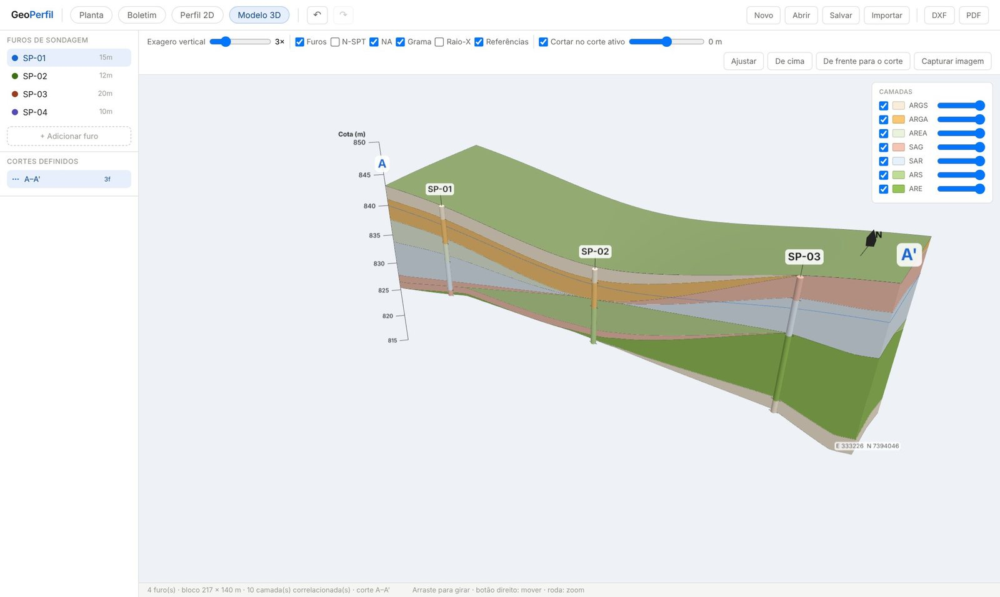

## Por que usar

- **Menos retrabalho no CAD.** O perfil sai com os contatos já interpolados entre os furos, as hachuras, a régua de N-SPT, o NA, as escalas e a legenda. O DXF tem uma layer por material com hatch sólido, cada furo como bloco com atributos e textos no tamanho certo para plotar.
- **Lançamento rápido.** Os metros já aparecem prontos até a profundidade limite. Enter ou Tab pula para o próximo, metro vazio repete a classificação de cima e dá para colar colunas direto do Excel.
- **Coordenadas reais.** UTM SIRGAS 2000 ou latitude/longitude, com mapa de fundo, e exportação para o Google Earth.
- **Visão 3D do subsolo** para apresentar ao cliente e à equipe, a partir dos mesmos dados do perfil.
- **Seus dados ficam com você.** O app roda no navegador e salva o projeto automaticamente no seu computador. Nada é enviado para servidor.

## Como funciona

1. **Planta**: lance os furos por clique, por coordenadas ou importando CSV, XLSX, GeoJSON ou KML.
2. **Boletim**: preencha classificação, descrição e N-SPT de cada metro.
3. **Corte**: trace a linha na planta. O lado em que você clica define quais furos entram.
4. **Entregue**: PDF do perfil em A3, boletim em PDF, DXF, modelo 3D e imagens.

## Planta georreferenciada

Furos e cortes em coordenadas UTM SIRGAS 2000 (fusos 18 a 25 S e 18 a 22 N) ou locais, sobre mapa OpenStreetMap, satélite ou sem mapa. A faixa do corte mostra quais furos entram no perfil, e a ferramenta de medir dá distâncias na hora.

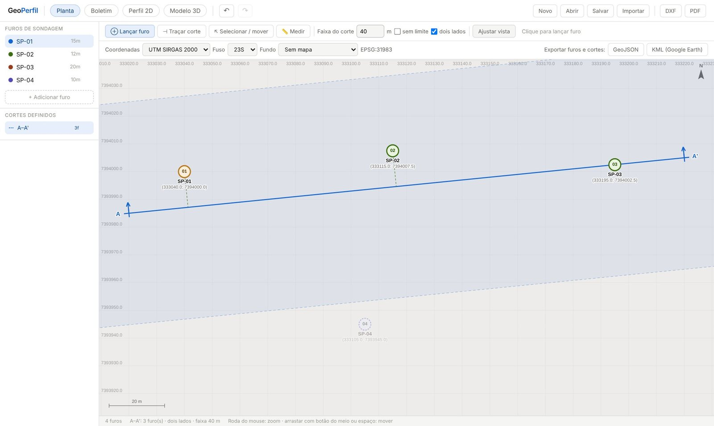

## Boletim metro a metro

A coluna do furo é desenhada enquanto você digita. O N-SPT pode ser lançado metro a metro ou por golpes a cada 15 cm, com penetração incompleta no formato `30/12`. O gráfico de N-SPT compara todos os furos, e o boletim de cada furo sai em PDF.

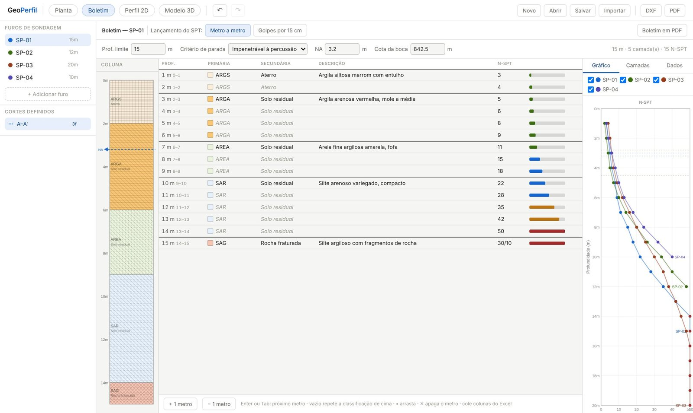

## Perfil 2D com contatos interpolados

Camadas de mesma classificação são correlacionadas entre furos vizinhos e ligadas em linha reta. Uma camada que só existe num furo acunha no meio do vão, e um trecho sem correlação vira transição lateral. Se a interpretação pedir, use **Ajustar contatos**: as alças ◆ movem para os lados as pontas das cunhas e as transições, e a alça ●, que aparece ao passar o mouse num contato, sobe ou desce esse contato entre os furos para mudar a espessura das camadas (nos furos vale o boletim); o ajuste fica salvo no corte e vai junto para o PDF e o DXF. O desenho pode ser **Interpolado** (contatos em linha reta), **Suave** (terreno, NA e contatos em curva, que passam pelos furos sem ultrapassar os valores deles) ou **Degrau** (troca de material no meio do vão), escolhido por corte.

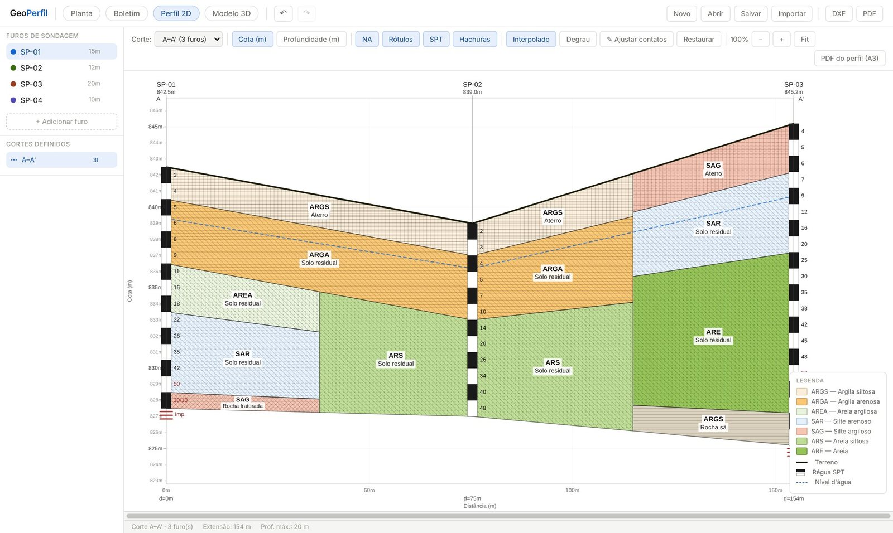

### Padrão de prancha

As camadas podem ser coloridas pelo **tipo de solo** ou pela **origem do solo** (aterro, colúvio/tálus, solo residual, rocha alterada, rocha fraturada, rocha sã), como nas pranchas de projeto. Pedregulho e blocos aparecem como matacões em volta do furo, o topo rochoso ganha a marcação em vermelho e as sondagens mistas mostram o N-SPT de um lado e a recuperação (REC %) do outro. Na janela **Desenho…** entram o NA de projeto, as linhas de referência (fundo de escavação, cota de assentamento) e o N-SPT em golpes/30 cm. A tela, o PDF, o DXF e o 3D saem do mesmo desenho.

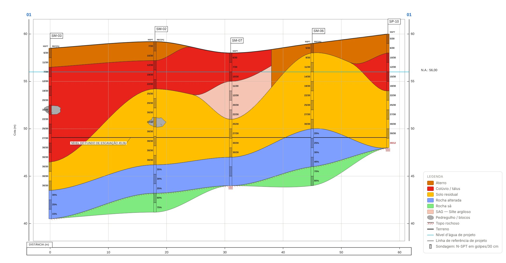

## Modelo 3D do terreno

Um bloco geológico sólido montado a partir dos furos **e dos perfis 2D**. Ao longo de cada corte, o 3D reproduz o Perfil 2D, inclusive os contatos ajustados à mão: arrastou uma transição no 2D, o 3D acompanha. Entre os cortes, a cota do terreno, a espessura de cada camada e o NA são interpolados a partir das sondagens. O bloco abre no alinhamento do corte ativo e mostra os furos e o N-SPT na face. Os botões **Ver no 3D** (no Perfil 2D) e **Ajustar contatos no 2D** (no 3D) levam de uma aba à outra.

| Bloco inteiro | Face do corte A–A' |
|---|---|
| 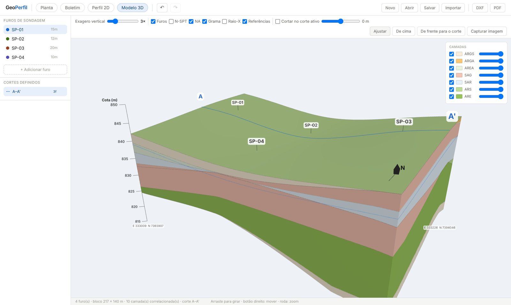 | 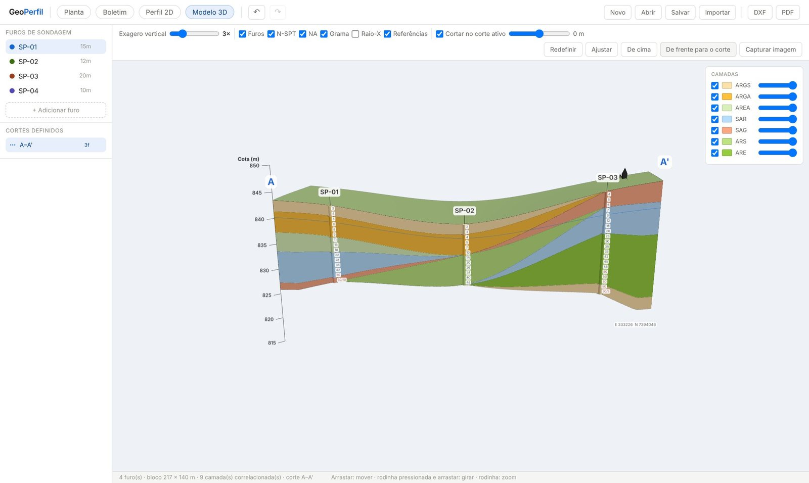 |

Também tem exagero vertical, raio-X para ver os furos por dentro e transparência e visibilidade por classificação. Há ainda régua de cotas, coordenadas e norte. Passando o mouse, aparecem a camada e a cota daquele ponto, e a vista pode ser salva em imagem.

## Pronto para entregar

### Prancha de perfis (A0 a A3)

O botão **Prancha** monta a folha com os cortes escolhidos, todos na mesma escala (a maior que couber no formato), com planta-chave, legenda, notas e carimbo com tabela de revisões. Os dados do carimbo ficam salvos no projeto. Sai em PDF e em DXF.

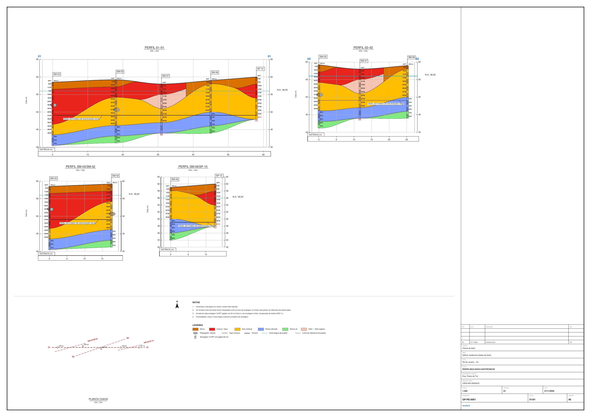

### Perfil, boletim e DXF

| PDF do perfil em A3 | Boletim de sondagem em PDF |
|---|---|
| 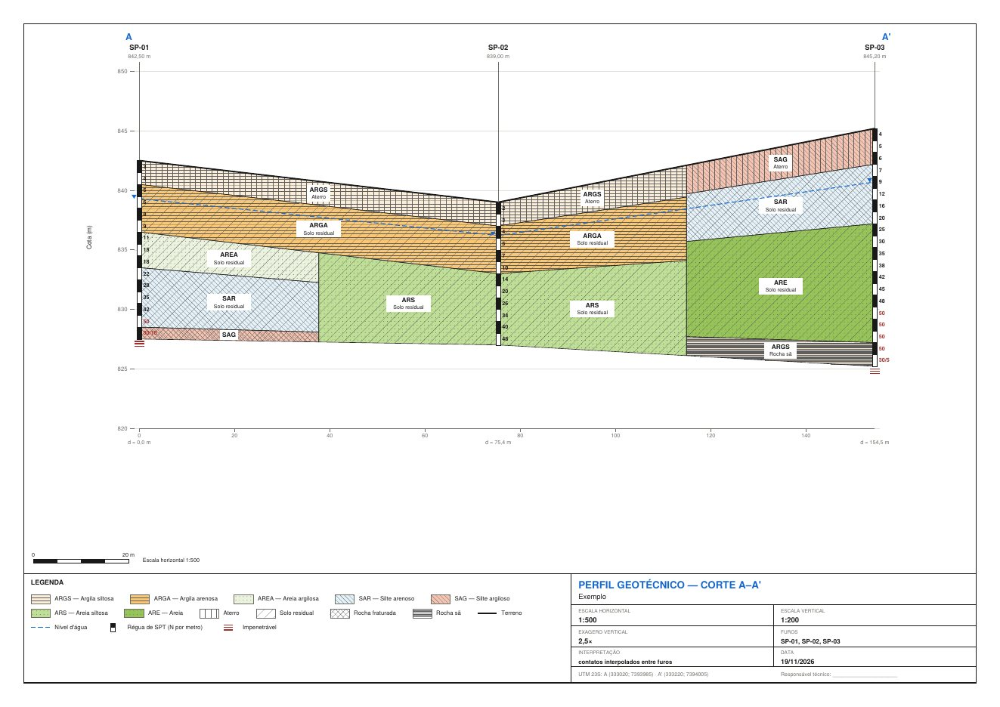 | 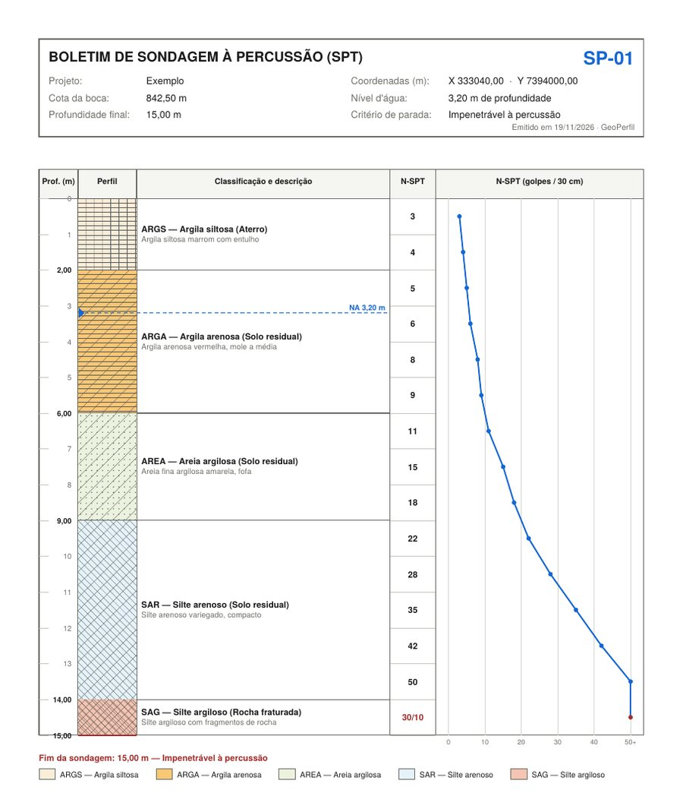 |

**PDF do perfil em A3**: escalas horizontal e vertical padronizadas, exagero vertical, escala gráfica, legenda e carimbo.

**Boletim em PDF**: perfil do furo com hachuras, classificação e descrição, N-SPT, gráfico, NA e critério de parada.

**DXF para o CAD** (AutoCAD 2007): perfil no mesmo layout e nas mesmas escalas do PDF, uma layer por material com hatch sólido, contatos em polilinha, cada furo como bloco com atributos (nome, N-SPT e REC de cada metro), textos em ROMANS com acentos e a planta de locação.

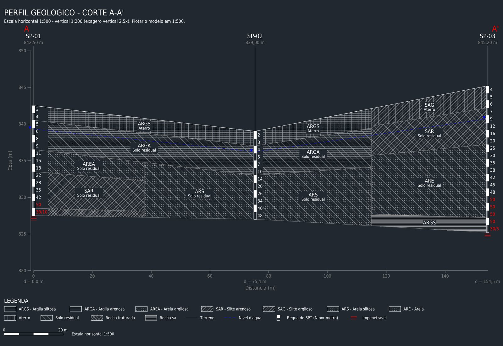

## Formatos

| Entrada | Saída |
|---|---|
| CSV e XLSX (furos, camadas e N-SPT, inclusive com abas separadas) | DXF 2007 (perfil e planta, ou prancha) |
| GeoJSON e KML (pontos) | PDF da prancha (A0 a A3), do perfil (A3) e do boletim |
| Projeto GeoPerfil (JSON) | GeoJSON e KML (Google Earth), projeto em JSON, imagem do modelo 3D |

A importação reconhece os cabeçalhos `furo, x, y, lat, lon, cota, na, prof_total, de, ate, primario, secundario, descricao, prof, nspt`. Modelos de CSV e XLSX podem ser baixados dentro do app.

## Desenvolvimento

Feito em JavaScript com Vite, three.js, Leaflet, proj4 e jsPDF. As funções de cálculo (correlação de camadas, interpolação, escalas, DXF) são separadas da interface e cobertas por 113 testes automatizados (Vitest).

```bash
npm install
npm run dev      # servidor local
npm test         # testes
npm run build    # gera dist/
```

A cada push na `main`, o GitHub Actions roda os testes e publica o site no GitHub Pages.

<details>
<summary>Estrutura do código e formato do projeto</summary>

```
src/
  main.js          ligação entre estado, vistas e ações
  store.js         estado do projeto, desfazer/refazer, salvamento automático
  model/           catálogo de solos, modelo de dados e arquivo de projeto
  geo/             corte, perfil 2D (correlação), modelo em bloco 3D, coordenadas
  views/           planta, boletim, perfil 2D e modelo 3D
  io/              CSV/XLSX, DXF, PDFs, GeoJSON/KML, hachuras, escalas
  styles/
tests/             testes unitários
```

Tudo em metros. `x` = Leste e `y` = Norte (UTM SIRGAS 2000 no fuso `fusoUTM` quando `crs` = `utm`, coordenadas locais quando `crs` = `local`). `metros` guarda só o que foi digitado, e o metro *m* vai de *m − 1* a *m*. Classificação vazia repete a de cima, e as camadas são calculadas a partir disso.

```json
{
  "version": 2,
  "projeto": { "nome": "Obra X", "crs": "utm", "fusoUTM": "23S", "fundo": "mapa", "modoSPT": "metro" },
  "cores": { "ARE": "#97C459" },
  "furos": [{ "id": "…", "nome": "SP-01", "x": 333040, "y": 7394000, "cota": 842.5, "na": 3.2,
              "profTotal": 15, "parada": "imp_percussao",
              "metros": [{ "m": 1, "codigo": "ARGS", "origem": "ATR", "desc": "Argila siltosa marrom", "spt": "3" },
                         { "m": 2, "spt": "4" },
                         { "m": 3, "codigo": "ARE", "golpes": ["5", "6", "7"] }] }],
  "cortes": [{ "id": "…", "nome": "A–A'", "p1": [333020, 7393985], "p2": [333220, 7394005], "lado": 1, "faixa": 40 }]
}
```

</details>

## Roadmap

- [x] Fase 0 — Fundação (Vite, módulos, store, desfazer/refazer, testes, deploy)
- [x] Fase 1 — Correções e modelo de dados v2
- [x] Fase 2 — Boletim metro a metro e boletim em PDF
- [x] Fase 3 — Planta georreferenciada (Leaflet, UTM SIRGAS 2000, GeoJSON/KML)
- [x] Fase 4 — Perfil 2D v2 (contatos interpolados, ajuste manual, PDF A3 com carimbo, DXF)
- [x] Fase 5 — Modelo 3D com three.js (bloco geológico interpolado, ligado ao Perfil 2D, corte no alinhamento do corte ativo)
- [x] Fase 5b — Padrão de prancha (cores por horizonte, blocos, topo rochoso, sondagem mista, NA de projeto, DXF 2007 com blocos e atributos, prancha A0–A3)
- [ ] Fase 6 — Classificação SUCS e integração com os apps de fundações
